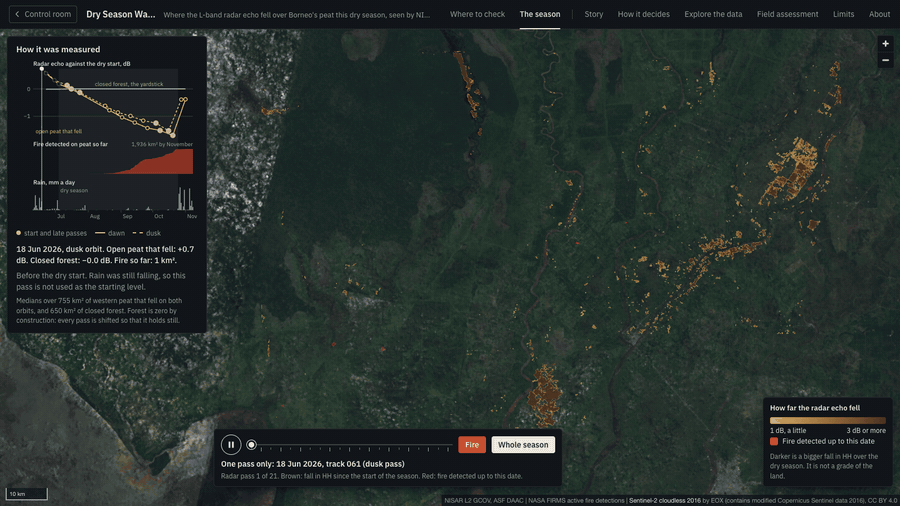
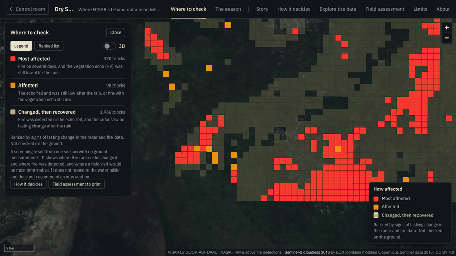
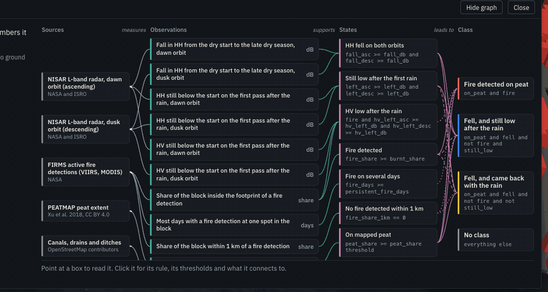
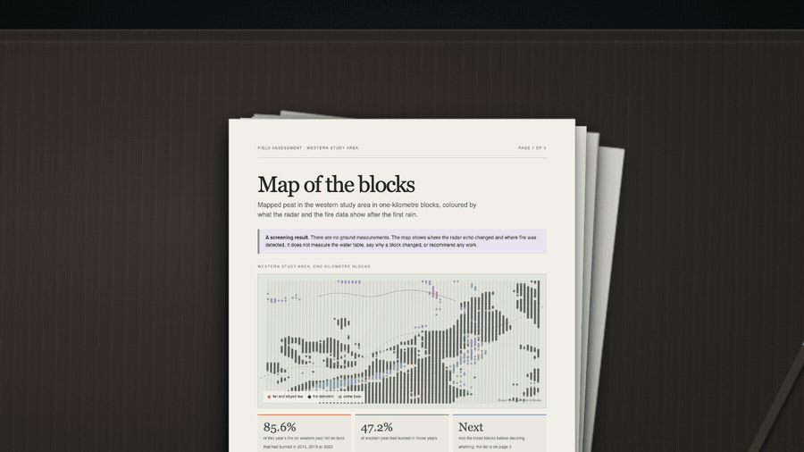
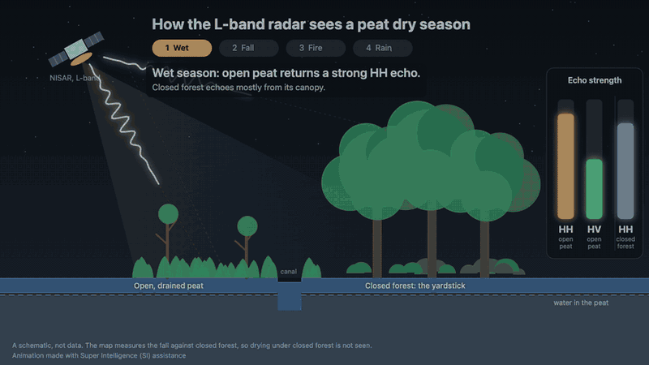

# Dry Season Waltz

Team Garugons, NASA Space Apps Challenge 2026, challenge "Dancing with the SARs".

Built on 14 and 15 November 2026.

- **Open the map:** https://tommyquak.github.io/GarugonsSpaceApps/
- **The seven demo slides:** https://docs.google.com/presentation/d/1vesg1eznCPqGbcpzD-PjqL7T5cbiIpfgGebKZvpY5_A/edit?usp=sharing

## What it is

An open web map that uses the first dry season seen by the NASA-ISRO NISAR radar over Borneo's peatlands to show three things:

1. **The fall.** Where the radar echo fell over the dry season, pass by pass, through cloud and smoke.
2. **Fire.** Where NASA's FIRMS detected fire.
3. **The first rain.** Where the echo rose again on the first pass after the rain, and where it did not.

It is a screening map that shows where to look. It does not measure the water table, predict fire or recommend an intervention. Part way through we asked a Super Intelligence (SI) reviewer to audit the work, and changed it: see `docs/AUDIT.md` and `docs/LIMITS.md`.

## See it working

Recordings of the live app. Each one is the real site, not a mock-up.

**The season.** Every NISAR pass on both orbits, July to November 2026: the radar echo falls through the dry season, and NASA's fire detections build up beside it.



**Where to check.** Every 1 km block of mapped peat in one of three levels, flat or in 3D, with the ranked list that exports to CSV and GeoJSON, and one block's evidence.



**How it decides.** The rule behind every class, drawn from its file: sources, observations, states and classes, each with its threshold.



**Field assessment.** Three pages to print for a field team, ending in the blocks to visit first.



**What the radar sees.** An animated schematic of how the L-band echo changes as open peat dries, burns and is wetted again. A schematic, not data; made with SI assistance and marked as such.



## Repository layout

| Folder | What is in it |
|---|---|
| `pipeline/` | Python that turns NISAR files into map layers and a file of validation numbers |
| `app/` | The web map |
| `submission/` | Project page text, slides and the record of SI use |
| `docs/` | Data contract, limits, references, the design and the audit; `docs/media/` holds the recordings above |
| `tools/` | The team's agent message board |

For how the team works, see `PLAN.md` and `AGENTS.md`.

## Run it yourself

Everything shown in the app is produced by the code in `pipeline/`, from NASA's archive to the numbers.

You need Python 3.11 or later, Node 22 for the app, and the GitHub CLI (`gh`) to download the released files. Run every command from the repository root.

### The pipeline

```
pip install -r requirements.txt

# quick: start from the radar stacks we publish (about 600 MB), a few minutes
gh release download data-v1 --repo tommyquak/GarugonsSpaceApps --dir pipeline/out/stacks --pattern '*_125.npz'
gh release download data-v5 --repo tommyquak/GarugonsSpaceApps --dir pipeline/out/stacks --pattern '*_061.npz'
SKIP_PULL=1 pipeline/run_all.sh

# full: pull the NISAR windows yourself (needs a NASA Earthdata login in ~/.netrc), a few hours
pipeline/run_all.sh
```

The dawn orbit (track 125) is in `data-v1` and the dusk orbit (track 061), with its pass after the rain, in `data-v5`. Both are needed.

The quick path rebuilds the fall, the forest spread and the change after the rain. The steps that need fire, peat and canal layers (the split by peat and fire, and the 1 km blocks) are skipped unless those layers are in `pipeline/out/layers`. To include them, download them first:

```
gh release download data-v9 --repo tommyquak/GarugonsSpaceApps --dir pipeline/out/layers \
  --pattern 'fire_*' --pattern 'peat_peatmap_*' --pattern 'canal_*' --pattern 'rain_daily_*'
```

or rebuild them from NASA's services with `WITH_CONTEXT=1 pipeline/run_all.sh` (`pipeline/context/README.md` says what that needs).

| Step | Code | What it does |
|---|---|---|
| Pull | `pipeline/radar/pull_gcov.py` | Reads only the part of each NISAR L2 GCOV granule that covers a site |
| Stack | `pipeline/radar/build_stack.py` | HH and HV at 50 m, in decibels, both orbits on one grid |
| Dry season | `pipeline/season.py` | Reads the start and the end of the dry season from the daily rainfall, by a fixed rule |
| Reference | `pipeline/drying/reference.py`, `baseline.py` | Deep intact forest as the yardstick, and the scene-wide shift of each pass |
| The fall | `pipeline/drying/drydown.py`, `per_pass.py` | How far HH fell over the dry season, and one layer per pass |
| Forest spread | `pipeline/drying/noise_floor.py` | The 5th percentile of change in the reference forest, on both orbits |
| Fire, rain, peat, canals | `pipeline/context/` | The layers from NASA FIRMS, GPM IMERG, PEATMAP and OpenStreetMap (`pipeline/context/README.md`) |
| After the rain | `pipeline/recovery/recovery.py` | What changed in HH and in HV on the first pass after the rain |
| Blocks and classes | `pipeline/fusion/blocks.py`, `ontology.json` | One record per 1 km block, with its class and the reasons (`docs/FUSION.md`) |
| Water-table model | `pipeline/hydro/` | A rainfall-driven model beside the radar; optional, `WITH_HYDRO=1` (`pipeline/hydro/README.md`) |
| Our own checks | `pipeline/drying/selfcheck.py`, `sensitivity.py` | Tests for artefacts and for our own choices |
| Independent checks | `pipeline/checks/` | A second team member recomputes the reported numbers (`pipeline/checks/README.md`) |
| Figures | `pipeline/figures.py` | The figures on the slides, drawn from the outputs |
| App data | `pipeline/drying/series.py`, `app/scripts/` | Files the web map reads (`app/README.md`) |

Tests: `python -m pytest pipeline/tests pipeline/checks` (80 tests; they need no data).

Outputs land in `pipeline/out/`. The numbers are in `pipeline/out/validation.json`; the copy the app and the slides read is `app/public/validation.json`. The built files are attached to the data releases, the latest being `data-v9`.

### The app

```
cd app
npm ci
npm run dev        # the map at http://localhost:5173/GarugonsSpaceApps/
npm run build      # type-check, then build to app/dist
```

The layers and numbers the map reads are committed under `app/public/`, so the app runs without the pipeline. Every push to `main` builds it and publishes it to GitHub Pages (`.github/workflows/pages.yml`). `app/README.md` has the rest.

## Data

| Dataset | Agency | Source |
|---|---|---|
| NISAR L2 GCOV backscatter (HH, HV) and L2 GUNW coherence | NASA and ISRO | Alaska Satellite Facility DAAC, https://search.asf.alaska.edu |
| GPM IMERG daily rainfall | NASA | GES DISC, https://disc.gsfc.nasa.gov |
| FIRMS active fire detections (VIIRS, MODIS) | NASA | https://firms.modaps.eosdis.nasa.gov |
| Waterways | OpenStreetMap contributors | https://www.openstreetmap.org |
| PEATMAP peat extent, CC BY 4.0 | Xu, Morris, Liu and Holden 2018, University of Leeds | https://doi.org/10.5518/252 |
| Sentinel-2 cloudless 2016 mosaic (basemap), CC BY 4.0 | EOX, from Copernicus Sentinel data (ESA) | https://cloudless.eox.at |
| Blue Marble imagery (basemap option) | NASA GIBS | https://earthdata.nasa.gov/gibs |
| VIIRS daily true colour, `VIIRS_SNPP_CorrectedReflectance_TrueColor` (ground look in the place card) | NASA GIBS, Suomi NPP | https://earthdata.nasa.gov/gibs |

## Use of Super Intelligence (SI)

This project is built with SI coding assistants working under each team member's direction. Code files written with SI assistance say so in their first comment line, and `submission/si_use/` records where SI was used, one file per team member.

## Licence

MIT. See `LICENSE`.
